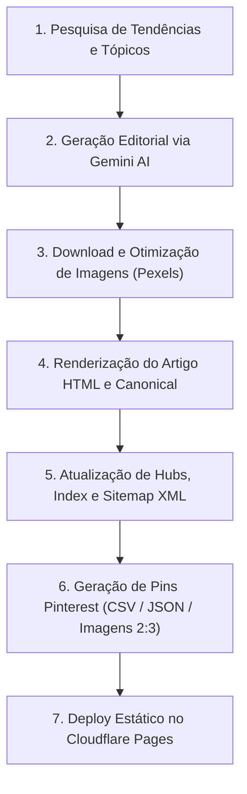

# Homewise Living — Editorial Home & Lifestyle Platform

Plataforma editorial e guia de compras de afiliados voltada para o mercado dos Estados Unidos, focada em organização da casa, decoração de interiores, itens essenciais de cozinha, jardinagem, home office, casa inteligente e convivência com pets.

O projeto combina a estética de uma revista de lifestyle americana de alto padrão (*Modern Organic Living*) com um sistema automatizado de ponta a ponta para geração de conteúdo, publicação estática ultra-rápida no **Cloudflare Pages** (`https://homewise-living.pages.dev`) e automação de tráfego no Pinterest.

---

## 📌 Sumário
- [Visão Geral e Posicionamento](#-visão-geral-e-posicionamento)
- [Identidade Visual e Design System](#-identidade-visual-e-design-system)
- [Arquitetura do Pipeline](#-arquitetura-do-pipeline)
- [Categorias e Editorias](#-categorias-e-editorias)
- [Sistema de Afiliados e Monetização](#-sistema-de-afiliados-e-monetização)
- [Automação de Tráfego no Pinterest](#-automação-de-tráfego-no-pinterest)
- [Configuração e Variáveis de Ambiente](#-configuração-e-variáveis-de-ambiente)
- [Estrutura do Repositório](#-estrutura-do-repositório)
- [Execução Local e Testes](#-execução-local-e-testes)
- [Deploy e Hospedagem](#-deploy-e-hospedagem)

---

## 🏡 Visão Geral e Posicionamento

O **Homewise Living** (*"Smart Ideas for a Better Home."*) é um destino prático, inspirador e confiável para pessoas que desejam transformar e otimizar suas casas através de soluções inteligentes, produtos úteis e ideias acessíveis de organização e design.

### Pilares da Plataforma:
1. **Identidade Visual Premium (Modern Organic Living)**: Tipografia editorial clássica aliada a uma paleta natural e acolhedora centrada no verde *Forest Green*, *Warm Ivory*, *Soft Beige* e toques de *Terracotta*.
2. **Arquitetura Estática de Alta Performance**: Hospedado no Cloudflare Pages através de *Clean URLs* sem dependência de banco de dados ou CMS pesado, garantindo notas máximas no Google Core Web Vitals.
3. **SEO Técnico Avançado**: URLs limpas sem extensão `.html`, Sitemap XML automatizado, Schema.org completo (`Article`, `BreadcrumbList`, `FAQPage`, `WebSite`, `Organization`), Open Graph e Twitter Cards.
4. **Sistema de Monetização e Afiliados Ético**: Componentes estilizados para recomendação de produtos, tabelas comparativas e caixas de prós/contras, com suporte a links patrocinados (`rel="sponsored nofollow"`) e avisos transparentes de afiliação.
5. **Automação de Tráfego no Pinterest**: Criação de múltiplos Pins verticais em alta resolução (1000×1500) com overlay tipográfico e pacotes de rascunhos em CSV/JSON para o Pinterest Bulk Upload com parâmetros UTM.

---

## 🎨 Identidade Visual e Design System

O design do site foi construído sob o conceito de **Modern Organic Living**, equilibrando calor, sofisticação e praticidade.

### 1. Paleta de Cores e Tokens CSS
- **Primary Background (Warm Ivory):** `#F7F5F0` — Superfície principal acolhedora e agradável aos olhos.
- **Secondary Background (Soft Beige):** `#E9E2D6` — Superfícies secundárias, divisores e bordas refinadas.
- **Primary Brand (Forest Green):** `#34483B` — Assinatura visual da marca: cabeçalho, botões principais, links de destaque e rodapé.
- **Secondary Brand (Sage Green):** `#DCE3D5` — Acentos suaves, pills de categorias e fundos de destaque.
- **Accent (Warm Terracotta):** `#C49A72` — Detalhes decorativos e contrastes.
- **Primary Text (Charcoal):** `#292D29` — Leitura nítida de alto contraste.
- **Secondary Text (Muted Gray):** `#77776F` — Metadados, datas e descrições secundárias.
- **Pure White:** `#FFFFFF` — Superfícies de cartões e blocos de conteúdo.

### 2. Tipografia Editorial
- **Títulos e Headings:** `Playfair Display` (serif editorial) — Elegância e presença de publicação impressa.
- **Corpo e Interface:** `DM Sans` (sans-serif moderno) — Legibilidade e clareza para navegação, botões e leitura contínua.
- **Escala Responsiva com `clamp()`:** Tipografia proporcional adaptada a smartphones, tablets e desktops.

### 3. Logotipo e Marca
Wordmark sofisticado acompanhado do símbolo de casa minimalista com linha contínua, presente no header desktop, mobile e rodapé escuro.

---

## 🏗️ Arquitetura do Pipeline

O pipeline automatizado do site pode ser executado manualmente ou agendado via GitHub Actions (`daily.yml`):



---

## 📂 Categorias e Editorias

A arquitetura de conteúdo do **Homewise Living** organiza-se em 6 editorias principais para o público americano:

| Categoria | Slug / Hub | Descrição |
|-----------|------------|-----------|
| **Home Organization** | `/tag/home-organization` | Métodos de descarte, organização de closets, despensas e sistemas funcionais. |
| **Kitchen & Cooking** | `/tag/kitchen` | Utensílios indispensáveis, meal prep e eletrodomésticos para cozinhar melhor. |
| **Home Decor** | `/tag/decor` | Ideias de ambientação, design de interiores aconchegante e reformas econômicas. |
| **Garden & Outdoor** | `/tag/garden` | Paisagismo residencial, plantas para interiores, hortas urbanas e varandas. |
| **Home Office** | `/tag/home-office` | Espaços de produtividade, ergonomia e dispositivos para casa inteligente. |
| **Pet-Friendly Home** | `/tag/pets` | Móveis resistentes, plantas seguras para pets e organização de suprimentos animais. |

---

## 💎 Sistema de Afiliados e Monetização

O site incorpora um ecossistema nativo de componentes para monetização ética:
- **Product Recommendation Cards (`.product-card`)**: Cartão com foto de produto, badge temático, especificação do vendedor, preço verificado e botão de ação (*"Check Price"*, *"View on Amazon"*).
- **Tabelas Comparativas (`.comp-table`)**: Tabelas responsivas com destaque visual para o produto recomendado (*"Editor's Pick"*).
- **Prós e Contras (`.pros-cons-grid`)**: Caixas visuais comparativas com ícones orgânicos verdes e terracota.
- **Aviso de Afiliados (`.affiliate-disclosure`)**: Banner transparente em conformidade com as diretrizes do FTC (Federal Trade Commission) dos EUA.

---

## 📌 Automação de Tráfego no Pinterest

O Pinterest é o principal canal de tráfego orgânico do projeto. O gerador cria automaticamente:
- **Formato Vertical Otimizado (2:3 / 1000×1500)**: Padrão recomendado pela plataforma para máximo destaque no feed.
- **Múltiplos Ângulos por Post**:
  1. *Educational*: Focado no método e passo a passo.
  2. *Problem/Solution*: Focado em erros comuns e soluções práticas para casa.
  3. *SEO Search*: Focado em termos de alto volume de busca no Pinterest americano.
- **Pinterest Bulk Upload**: Exportação automática em `generated/pinterest/YYYY-MM-DD_pins.csv` com títulos de alta conversão, descrições detalhadas e links rastreados via parâmetros UTM.

---

## ⚙️ Configuração e Variáveis de Ambiente

Crie um arquivo `.env` na raiz do projeto ou configure as secrets no GitHub Actions:

| Variável | Obrigatória | Descrição |
|----------|-------------|-----------|
| `GEMINI_API_KEY_1` | Sim | Chave de API primária do Google Gemini. |
| `GEMINI_API_KEY_2..4` | Não | Chaves secundárias para failover automático em caso de limite de cota. |
| `GEMINI_MODEL` | Não | Modelo Gemini (padrão: `gemini-3.6-flash`). |
| `PEXELS_API_KEY` | Sim | Chave de API do Pexels para imagens em alta resolução livres de direitos autorais. |
| `BASE_URL` | Não | Domínio canônico público (padrão: `https://homewise-living.pages.dev`). |
| `SITE_TITLE` | Não | Nome da marca (padrão: `Homewise Living`). |
| `PINTEREST_ACCESS_TOKEN` | Não | Token de acesso para publicação direta via API do Pinterest. |
| `PINTEREST_BOARD_ID` | Não | ID da pasta do Pinterest onde os pins serão salvos. |
| `PINTEREST_ENABLE_PUBLISH` | Não | Ativar publicação direta via API (`1` ou `0`). |

---

## 📁 Estrutura do Repositório

```text
Homewise Living/
├── docs/                      # Arquivos estáticos servidos pelo Cloudflare Pages
│   ├── assets/                # Imagens dos artigos e folha de estilo (style.css)
│   ├── tag/                   # Hubs de categoria física (home-organization.html, etc.)
│   ├── index.html             # Homepage editorial do Homewise Living
│   ├── about.html             # Página institucional, missão e política de afiliação
│   ├── 404.html               # Página de erro customizada
│   ├── sitemap.xml            # Sitemap XML canônico atualizado automaticamente
│   └── robots.txt             # Diretivas para motores de busca
├── src/
│   └── app/
│       ├── config.py          # Configurações do ambiente e parâmetros de execução
│       ├── site.py            # Motor gerador HTML, templates e design system CSS
│       ├── topics.py          # Lista de tópicos e rotação das editorias de casa/lifestyle
│       ├── content.py         # Motor de geração de artigos via Gemini AI e validações
│       ├── repair_site.py     # Script de reconciliação de links, sitemap e canonicidade
│       ├── run_daily.py       # Fluxo mestre diário de geração, imagens e Pinterest
│       └── pinterest_seo.py   # Motor de geração de metadados, títulos e pins
├── tests/
│   └── test_seo_and_quality.py # Suíte de testes automatizados de SEO, links e integridade
├── melhorias.md               # Especificação visual detalhada e log de implementação
└── requirements.txt           # Dependências Python
```

---

## 🧪 Execução Local e Testes

### 1. Instalação de Dependências
```bash
python -m venv venv
venv\Scripts\activate       # No Windows (PowerShell)
pip install -r requirements.txt
```

### 2. Reconstruir e Reparar o Site Estático
Para regenerar o arquivo `docs/assets/style.css`, sitemap, canonicals e páginas de hub:
```bash
python -m src.app.repair_site
```

### 3. Executar os Testes Automatizados
```bash
python -m unittest discover tests
python test_pinterest_features.py
```
*Todos os testes devem passar com `OK` (10/10 na suíte de qualidade de SEO e 5/5 nos testes de Pinterest).*

---

## 🚀 Deploy e Hospedagem (Cloudflare Pages)

O deploy ocorre automaticamente via GitHub Actions quando commits são enviados para a branch `main`. A pasta raiz de publicação no Cloudflare Pages é configurada como `/docs`.
